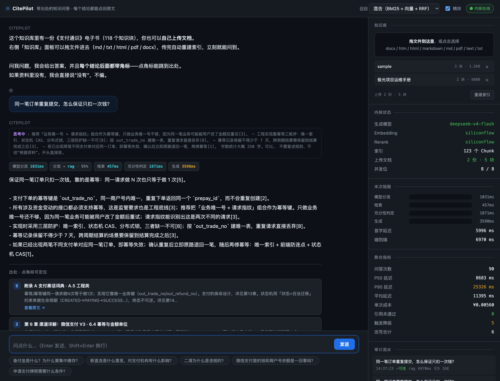

# CitePilot

**带出处的垂直知识问答 Agent** —— 答案里的每一句事实，都能点回原文的具体章节。

语料默认是一本 19 万字的支付领域电子书（25 章、118 个检索块），
也可以**随时上传自己的文档**（md / txt / html / pdf / docx），传完立即重建索引、马上能问。
它不是"调个 API 套个壳"的 RAG demo，而是一条完整链路：
三档意图分流 → 双路召回 → RRF 融合 → 精排 → **自纠正重检** → 带引用生成 → 引用校验 → 全链路 trace → 评测回归。



> 上图：一次真实问答。回答里的 `[5]` `[2]` `[8]` 可以点开出处在下方卡片；
> 右侧面板是这次请求的完整 trace（检索 457ms → 生成 3598ms，成本 ¥0.0055，引用校验 0 越界）。

---

## 为什么做这个

「给出答案时提供出处」看起来是个小需求，落地要解决五个真问题：

| 问题 | 难点 | 本项目的解法 |
|---|---|---|
| 让模型愿意标引用 | prompt 里写"必须标"没用，模型会先凭记忆答完再随手补角标 | 系统提示里明确"无资料支撑的断言一律不许写"，并给出反例 |
| 让引用是**真的** | 模型可能写出 `[7]` 而本次只召回了 5 条 | 生成后逐条校验角标编号是否越界，越界即视为幻觉 |
| 校验不过怎么办 | 直接报错等于服务不可用 | 把失败原因回灌给模型重写一次；再不过就降级为**原文摘录**，宁可不流畅也不编造 |
| 引用**点得开**吗 | 角标做得再漂亮，点下去 404 也是白搭 | 内置语料由网关挂 `/corpus/**` 静态托管，上传文档由 `/api/kb/.../raw` 给原文；前端一层 `resolveAnchor()` 把内核锚点翻成对外地址 |
| 怎么证明它变好了 | 没有数字的"优化"都是自我感觉 | 57 条人工可核对的评测集 + 三组对照实验，见下 |

---

## 关键数字（真实测量，可复现）

语料 118 个检索块 · 评测集 57 条（作者标注/词典自动生成） · 生成模型 DeepSeek · Embedding `BAAI/bge-m3` · Rerank `BAAI/bge-reranker-v2-m3`

### 实验 A：召回策略（术语式提问，57 条）

| 配置 | Recall@1 | Recall@3 | MRR | NDCG@10 | P50 延迟 |
|---|---|---|---|---|---|
| 纯 BM25 | 0.667 | 0.912 | 0.799 | 0.803 | <1 ms |
| 纯向量 | 0.772 | 0.965 | 0.863 | 0.818 | 232 ms |
| 向量+BM25+RRF | 0.719 | **0.982** | 0.839 | 0.830 | 220 ms |
| 上者 + 精排 | **0.895** | 0.982 | **0.936** | **0.843** | 727 ms |

**读法**：RRF 融合把"能不能捞到"（Recall@3/10）做到最好，但**把 Recall@1 拉低了**（0.772 → 0.719）——因为融合会抹平不同来源的分数尺度，"两路都排中游"的文档会挤掉"一路排第一"的文档。所以**融合之后必须精排**：精排把 Recall@1 从 0.719 提到 0.895（+17.6 个点），代价是 P50 延迟 +507ms。这个交换在"用户只读第一条答案"的场景里是划算的。

### 实验 A'：换成口语化提问（15 条，禁用一个专业术语）

| 配置 | Recall@1 | Recall@3 | Recall@10 |
|---|---|---|---|
| 纯 BM25 | 0.200 | 0.533 | 0.733 |
| 纯向量 | **0.600** | **0.800** | 0.800 |
| 向量+BM25+RRF | 0.533 | 0.667 | **0.867** |

**读法**：问法一变（"同一笔订单重复点，怎么保证只扣一次钱"——问的是"幂等"，但一个字面词都没重合），BM25 的 Recall@10 从 1.000 塌到 0.733。**在垂直领域，字面检索的脆弱性不是理论问题。**

### 实验 B：自纠正检索循环（口语化难样本，15 条）

| 配置 | Recall@8 | 触发重检比例 | 平均延迟 | P95 延迟 | 单次成本 |
|---|---|---|---|---|---|
| 单轮检索 | 0.800 | 0 | 12.0 s | 25.3 s | ¥0.0065 |
| 自纠正重检（≤2 轮） | **0.867** | 20% | 17.7 s | 45.7 s | ¥0.0069 |

**读法**：循环只在 20% 的查询上触发，一旦触发能把 Recall@8 补回 6.7 个点，成本几乎不变（+7%），**但延迟是长尾爆炸式的**——平均值 +48%，P95 几乎翻倍。所以不要只看平均值：**P95 是被少数需要重检的查询拖上去的**，治理长尾比优化平均更重要。

---

## 踩过的坑（每条都有现象 → 定位 → 根因 → 修复）

**1. 推理模型的 `max_tokens` 是"时间预算"**
现象：调用返回空字符串，但不报错。定位：打印原始响应发现 `content=''`、`finish_reason='length'`、`reasoning_tokens=199`（max_tokens=200）。根因：`deepseek-v4-flash` 是推理模型，先输出 `reasoning_content`，这些 token **也占 max_tokens 预算**。修复：`LLM.complete` 里加"预算翻倍重试"，检测到"内容为空且被长度截断"就自动放大重试。

**2. litellm 的隐藏重试会把超时放大 3 倍**
现象：设了 `timeout=5.0`，实际跑了 17.1 秒。定位：单独调用逐参数对比，发现 `num_retries=0` 时是 5.6 秒。根因：litellm 内部默认 `num_retries=2`（3 次尝试），和自己写的重试层相乘。修复：显式传 `num_retries=0`，重试策略只有一处。

**3. 一个 4 个字的"出处"**
现象：切分后最短的块只有 4 个字符（"读完之后"）。根因：短块合并只处理了"相邻"的情况，漏掉了排列在很前面、以及紧跟在问答块之后的短块。修复：补一轮兜底清理，向最近的散文块靠拢。

**4. 分词器不认识"备付金"**
现象：`备付金` 被切成 `['备付','金']`。根因：jieba 通用词典没有领域术语。修复：内置领域词典 + 从语料自带的术语表动态注入。

**5. 延迟被重复累加**
现象：真实 5.6 秒的问答上报成 12.7 秒。根因：`latency_ms` 把所有步骤相加，而其中有一个名为 `total` 的汇总步骤，它本身已包含其他步骤。修复：汇总项不参与汇总。

**6. 评测测成了"热缓存"**
现象：混合召回那组延迟只有 3ms，比纯向量那组（221ms）低两个数量级。根因：第二个配置命中了第一个配置留下的 embedding 缓存。修复：评测前清掉查询向量缓存 —— **测延迟必须测冷路径**。

**7. 一个被数据否掉的优化（负结果）**
想法：用 rerank 分数当"资料够不够"的代理信号，省掉每次问答的裁判调用（约 1.7s）。
验证：在口语化评测集上对比"top1 rerank 分"与"是否命中正确章节"——命中组最低 0.048，未命中组最高 0.918，**完全重叠**。
结论：**没上。** 裁判调用省不掉。这个负结果比一个"成功优化"更有价值 —— 它说明这个分数只反映"Query 与这条的相关度"，不反映"资料集是否完整"。

**8. 80 个测试全绿，服务却起不来**
现象：上传接口写完、单元测试 80 个全过、代码 review 也过了，但 `./scripts/dev.sh` 一跑就炸 ——
`RuntimeError: Form data requires "python-multipart" to be installed.`
定位：报错发生在 `create_app()` 里、FastAPI 解析 `UploadFile = File(...)` 这个签名的时候。
根因：**测试测的全是"函数"（切分、融合、引用校验），没有一个真去把应用装配起来** —— 而"缺依赖"这件事只在装配那一刻才暴露。
修复：装包 + 写进 `pyproject.toml` + 新增 `tests/test_server_smoke.py`，专门守四件事：
应用能装配、几个关键路由都注册上了、上传字段名必须叫 `file`（网关转发时用的是同一个名字）、
以及每种"对外宣称支持"的格式其抽取器都能 import（因为抽取器是懒加载的，缺依赖会被推迟到用户传文件那一刻才爆）。
顺带发现 `pypdf` / `python-docx` 也是同样的问题：装着、但没声明。**"我机器上能跑"是一种依赖缺陷。**

---

## 当前已知瓶颈：首字延迟（诚实版）

**先说结论：这个系统目前的首字延迟是 6~11 秒，不好看。** 这是真实测量，不是估的。

拆开看它慢在哪（一次典型问答，单位 ms）：

| 步骤 | 实测区间 | 说明 |
|---|---|---|
| `intent_llm` 意图分流 | 991 ~ 1434 | 一次 LLM 调用；规则命中时为 0 |
| `retrieve` 双路召回 + 精排 | 632 ~ 835 | 含一次 embedding + 一次 rerank API |
| `sufficiency` 充分性裁判 | 1317 ~ 4349 | 一次 LLM 调用，**波动最大** |
| `generate` 到首个 token | ~2000+ | 推理模型的 reasoning 阶段 |

四步**串行**，加一起就是首字延迟。

**为什么流式没有解决首字慢？**
因为流式优化的是"生成阶段"的等待感，而生成是**最后一步**。前面三次调用（分流、检索、裁判）一步都省不掉，不流式也得等。换句话说：流式把"3 秒的空白"变成了"3 秒的空白 + 逐字输出"，它没动大头。

这里有个**结构性**的原因：为了做到"答案必带出处 + 不够就重检"，我在检索和生成之间插了一次充分性判定。这是 Agent 与普通 RAG 的分界线，但代价就是多一次串行 LLM 调用。

### 三条优化路线（按性价比排序，都还没做）

1. **感知延迟：检索完就把候选出处推给前端。**
   检索在 ~2.5 秒时已经完成，此时完全可以先把"我找到了这几章"渲染出来（灰显待定），用户立刻知道系统在干活，而不是盯着空屏。生成完成后再把候选**确认**为正式引用。
   真实延迟一点没变，但体感从"卡死 10 秒"变成"3 秒有反馈"。**这条最划算。**

2. **`intent` 与 `retrieve` 并行。**
   两者互不依赖（分流只用来决定"要不要检索"，而 95% 的问题答案都是"要"）。并行能省掉较短的那一段。
   代价：命中 `direct` / `clarify` 时会白做一次检索（约 0.8s CPU + 一次 embed/rerank 调用）。这笔账划得来，但代码要从"同步两行"改成"线程池 + 结果合并"，属于结构变更，得单独做。

3. **`sufficiency` 换更快的方式。**
   它波动 1.3 ~ 4.3 秒，是因为当前用的推理模型（`deepseek-v4-flash`）会先在 `reasoning_content` 里想一大段。
   注意：**不要**试图用"top1 rerank 分"去替代裁判 —— 这个想法我试过了，见下面的负结果。真要做，方向是换一个非推理的小模型专门干判定这件事。

**为什么现在不做？** 因为前两条都要动结构，而当前版本的正确性（引用可信率 100%、102 个测试全绿）是刚验完的。在演示前一天动主链路，风险收益不匹配。**知道瓶颈在哪、知道怎么改、并且知道为什么现在不改** —— 这比"看起来很流畅"更能说明问题。

## 另一个已知缺陷：意图分流会间歇性反问

**先说清楚：这不是"偶尔"，约 1/6 的概率，而且我已经修了一半。**

同一条完全正常的问题（"XX 项目有几个节点？"）连问 6 次，模型给出的置信度是：

```
0.30  0.45  0.60  0.60  0.62  0.55
```

**同一个问题，模型自报的 confidence 在 0.30~0.62 之间随机跳。** 这不是信号，是噪声。
而 `intent.py` 原本的策略是"置信度 < 0.45 → 反问澄清" ——
于是那 0.30 的一次就把一个清清楚楚的事实型问题变成了"能不能再说具体点？"。

已经修掉的是更难看的那一半：**出口是"拒答"时，门槛从 0.75 单独抬到 0.90** ——
因为拒答最像"系统坏了"，而且实测出现过"模型说拒绝、置信度 0.85"的误判（比它给正确答案的 0.60 还自信）。
做法和验证写在 `tests/test_intent.py` 里，**用假 LLM 直接喂 (标签, 置信度)**，把阈值策略单独钉死 ——
不依赖真模型的随机性，所以这 15 个测试是稳定的。

**没修完的是"低置信 → 反问"这条老规则。** 它的意图是"问题本身模糊就反问"，
但实际触发它的是模型对置信度的自评，而那个自评不可信。
彻底的修法是"低置信也走检索"（检索有出处可核对，且下游还有充分性裁判兜底），
代价是真正模糊的问题要多花两次模型调用才给出"资料里没有"。
**这条留着 —— 因为"随机反问"用户还能看懂（他会换个说法再问），而"随机拒答"不能。**

**这个缺陷最值得讲的一点不是结论，是过程：** 我第一次验的时候连问 3 次拿到 2 对 1 错，
改完之后连问 5 次全对，差点就写"已修复"了。再连问 6 次才发现门槛一次都没触发过 ——
**"改完连测 5 次都过"在 1/6 的故障率下，本来就是大概率事件（约 40%）。**
所以最后真正被信任的是那 15 个不依赖模型的单测，不是那 5 次全对。


---

## 架构

```
接入层   Spring Boot 网关  gateway/  (Java 21 · WebFlux)
         ├── ChatController        /api/ask（非流式）· /api/ask/stream（SSE 透传）
         ├── KbController          /api/kb/**（列表 · 上传 · 删除 · 重建 · 取原文）
         ├── MetaController        /api/health · /api/stats · /api/recent · /api/sessions
         ├── StaticResourceConfig  /corpus/** → 内置语料目录（引用深链的落点）
         ├── RateLimiter           令牌桶（管速率）+ 信号量（管并发）
         ├── SessionStore          会话归属 · 轮次记录 · LRU 淘汰
         └── AuditLog              每轮问答落 JSONL（谁 · 何时 · 用了多少）
              ↓ HTTP + SSE  （内核是唯一上游，X-Internal-Token 鉴权）
编排层   Python Agent Core
         ├── server.py     FastAPI：HTTP + SSE 服务层，内核对外的唯一入口
         ├── intent.py     三档意图分流（规则 → LLM → 兜底澄清）
         ├── retriever.py  双路召回 → 去重 → RRF → 精排
         ├── judge.py      充分性裁判 + 查询改写 + 忠实度打分
         ├── answer.py     带引用生成 + 引用校验 + 摘录降级（含流式版）
         ├── agent.py      主循环（三道防死循环刹车 · RetrieveLoop 双路复用）
         ├── index.py      索引：内置语料 + 上传文档合并，支持原子热替换
         ├── kb.py         知识库：五格式抽取 · 清单管理 · manifest 原子写
         └── split.py      切分公共设施（章节装配 · 短块合并）
              ↓
底座     SQLite（会话 / trace / 评测）+ embedding 缓存（按单条文本 sha1）
         内置语料 corpus/（index.html 进 git，切分产物不进） · 上传文档 data/kb/（整个不进）
         DeepSeek（生成）· bge-m3（向量）· bge-reranker（精排）
```

**为什么内核是 Python、网关是 Java？**
内核要的是生态（模型、向量、评测指标）；网关要的是稳定性和工程约束（限流、熔断、审计、SSE 透传）——后者是 Java 后端的存量能力，而且把不确定性挡在网关之外，是这套系统能上生产的前提。

**为什么内核不直接对外，非要加一层网关？**
三个理由，都很实际：
1. **内核扩不了副本。** 它是单进程有状态的（内存里放着 118 条向量 + BM25 索引），前面必须有东西挡流量，否则并发一上来延迟就一起崩。
2. **职责不能混。** 鉴权、配额、会话属于"服务"层面的事，塞进内核会让它越来越难测 —— 内核应该只关心"答得对不对"。
3. **内核会被换掉。** 换模型、换检索库、甚至换语言，只要网关这条边界在，调用方一行都不用改。

---

## 项目结构

先看整棵树。看完它，你应该能回答两个问题：**哪些东西会随仓库发给别人，哪些只在你本机存在** —— 在这个项目里，这个区分比目录名本身重要，因为它决定了"别人 clone 下来能不能直接跑"。

```
CitePilot/
├── start.sh                      一键启动：内核 + 网关，前台阻塞，Ctrl-C 全停
├── pyproject.toml                依赖与入口（pip install -e . 后得到 citepilot 命令）
├── .env.example                  配置模板；真正的 .env 不进仓库
│
├── src/citepilot/                Python 内核 —— 所有问答逻辑都在这里
│   ├── server.py                 内核对外的唯一入口（HTTP + SSE）
│   ├── cli.py                    命令行入口（ask / serve / ingest / eval）
│   ├── agent.py                  主循环：分流 → 检索 → 裁判 → 重检 → 生成
│   ├── intent.py                 三档意图分流（规则 → LLM 分类 → 兜底澄清）
│   ├── retriever.py              两路召回 → 去重 → RRF → 精排 → Top-K
│   ├── index.py                  BM25 + 向量双路索引，支持原子热替换
│   ├── bm25.py                   纯 Python BM25（零依赖的稀疏检索兜底）
│   ├── embed.py                  Embedding 客户端（一套接口，三套实现）
│   ├── fusion.py                 RRF 融合
│   ├── judge.py                  充分性裁判 + 忠实度打分（LLM-as-judge）
│   ├── answer.py                 带引用生成 + 引用校验 + 摘录降级
│   ├── llm.py                    LLM 客户端：统一出口 + 分类重试 + token 记账
│   ├── ingest.py                 语料管线：把电子书 HTML 切成 Chunk
│   ├── kb.py                     上传知识库：五格式抽取 → 切分 → 落盘 → 增删
│   ├── split.py                  切分公共设施（被 ingest 与 kb 共用）
│   ├── schema.py                 统一数据结构；引用锚点在这里生成
│   ├── trace.py                  每轮链路落 SQLite（演示页右侧面板的数据源）
│   ├── evalkit.py                评测集构建 + 检索指标
│   └── config.py                 配置：只从环境变量与 .env 读
│
├── gateway/                      Java 网关 —— 只管接入，不含任何问答逻辑
│   ├── pom.xml
│   └── src/main/
│       ├── java/com/citepilot/gateway/
│       │   ├── GatewayApplication.java
│       │   ├── controller/       ChatController · KbController · MetaController
│       │   ├── service/          KernelClient · RateLimiter · SessionStore · AuditLog
│       │   ├── config/           GatewayProperties · WebClientConfig · StaticResourceConfig
│       │   └── model/            AskRequest
│       └── resources/
│           ├── application.yml   网关配置（全部可被环境变量覆盖）
│           └── static/index.html 演示页；纯静态，无前端构建步骤
│
├── tests/                        pytest 单测（8 个测试文件 + conftest + fixtures）
├── evals/                        评测集与对照实验脚本
├── scripts/                      kernel.sh · gateway.sh · dev.sh · build.sh
├── docs/screenshots/             README 首图
│
├── corpus/payment-handbook/      内置语料（那本支付手册）
│   ├── index.html                唯一的语料源，412K，同时被当作原文网页托管
│   └── chunks.jsonl              切分产物（118 块）；不进 git，可由上者重建
│
├── data/kb/                      用户上传的知识库 + 清单
├── var/                          SQLite / embedding 缓存 / 临时文件
└── gateway/target/               Maven 产物（25MB fat jar）
```

这张树里，**只有 `data/kb/`、`var/`、`gateway/target/` 和 `corpus/payment-handbook/chunks.jsonl` 不进仓库**，其余全部随 git 分发。`corpus/payment-handbook/index.html` 看似只是个演示文件，但它进 git 是有原因的：`chunks.jsonl` 是它的派生产物且被 ignore，所以它就是仓库里唯一的语料源，删掉它，clone 下来的人连索引都建不出来。

### 内核：19 个模块，按职责分四组

读这套代码的顺序建议就是下面这个顺序 —— 从入口往里走，不要从 `agent.py` 开始硬啃。

| 分组 | 文件 | 职责 | 值得知道的一点 |
|---|---|---|---|
| **入口与编排** | `server.py` | 内核对外的唯一入口 | 流式端点用同步 `def`，让 FastAPI 丢线程池跑，否则阻塞调用会把事件循环卡死 |
| | `cli.py` | 命令行入口 | 用 argparse 不用 Typer，少一个依赖 |
| | `agent.py` | 主循环，整个项目的枢纽 | 三道防死循环刹车；每轮都产出 trace 事件 |
| **理解问题** | `intent.py` | 三档分流：规则 → LLM 分类 → 兜底 | 兜底是**反问**，不是猜一个意图 |
| | `judge.py` | 充分性裁判 + 忠实度打分 | 两个用途共用一个实现，都走"给结构和判据"的提示词 |
| **检索** | `retriever.py` | 召回 → 去重 → RRF → 精排 → Top-K | 精排默认关闭，开了要额外付费 |
| | `index.py` | BM25 + 向量双路索引 | 内置语料与上传文档在这里合并；热替换靠一次引用赋值 |
| | `bm25.py` | 纯 Python BM25 | 自己写是因为它只有 30 行、且是**降级底座**：向量服务挂了、断网了，这条路必须在 |
| | `embed.py` | Embedding 客户端 | 三个实现：`bm25`（不算向量）/ `ollama`（本地）/ `siliconflow`（云），配置一行切换 |
| | `fusion.py` | RRF 融合 | 只用排名不用分数，避免两路分数量纲打架 |
| **生成与引用** | `answer.py` | 生成 + 引用校验 + 摘录降级 | 校验不通过的句子不硬编，降级成摘录；"答案必带出处"的最后一道防线 |
| | `llm.py` | LLM 客户端 | litellm 之上再包一层：分类重试、token 记账、超时 |
| **数据与观测** | `ingest.py` | 电子书 → Chunk | 顺带抽出自测题与术语，作为评测集原料 |
| | `kb.py` | 上传知识库 | 0 个块就回滚，不留幽灵记录 |
| | `split.py` | 切分公共设施 | 章节装配、短块合并 |
| | `schema.py` | 数据结构 | 锚点拼接逻辑在这里，不在前端 |
| | `trace.py` | 链路落库 | 演示页 trace 面板只读它 |
| | `evalkit.py` | 评测工具 | README 里的 Recall@K / MRR 都由它算 |
| | `config.py` | 配置 | 代码里零硬编码密钥，缺 key 时自动降级成抽取式回答 |

### 网关：12 个类，一个类只干一件事

| 包 | 文件 | 职责 |
|---|---|---|
| 根 | `GatewayApplication` | Spring Boot 启动类 |
| `controller` | `ChatController` | `/api/ask`（非流式）、`/api/ask/stream`（SSE 透传，逐块转发不攒） |
| | `KbController` | `/api/kb/**`：上传、列表、删除、重建、取原文 |
| | `MetaController` | `/api/health`、`/api/stats`、`/api/recent`、`/api/sessions` |
| `service` | `KernelClient` | **整个网关唯一真的发 HTTP 出去的地方**；内核要换地址只改这里 |
| | `RateLimiter` | 两道闸：令牌桶管速率、信号量管并发 |
| | `SessionStore` | 会话归属、轮次记录、LRU 淘汰 |
| | `AuditLog` | 每轮问答落一条 JSONL |
| `config` | `GatewayProperties` | 全部配置项，yml 写、环境变量覆盖 |
| | `WebClientConfig` | 上游 HTTP 客户端（超时、缓冲、编解码） |
| | `StaticResourceConfig` | 把 `corpus/` 挂到 `/corpus/**`；目录不存在只 WARN 不拦启动 |
| `model` | `AskRequest` | 请求体 |

### 代码之外的四个目录

| 路径 | 是什么 | 删了会怎样 |
|---|---|---|
| `tests/` | 单测，覆盖切分、融合、意图、引用校验、知识库、流式、冒烟 | 失去回归保护。注意：语料相关用例现在是 `skipif`，缺语料会"静默变绿"而不是报错 |
| `evals/` | `goldenset.jsonl`（57 条）+ `goldenset_hard.jsonl`（15 条）+ `run_eval.py` | README 里那些 Recall 数字再也复现不了 |
| `scripts/` | 四个脚本：`kernel.sh` / `gateway.sh` / `dev.sh` / `build.sh` | `start.sh` 直接不可用 |
| `docs/screenshots/` | 首图（800K PNG） | README 图片裂开，功能无影响 |

### 两条最容易搞混的边界

**`corpus/` 与 `data/kb/` 都是"资料"，但不是一回事。**

| | `corpus/payment-handbook/` | `data/kb/` |
|---|---|---|
| 谁的资料 | 项目自带的演示语料 | 用户自己上传的 |
| 进 git 吗 | `index.html` 进，`chunks.jsonl` 不进 | 整个不进 |
| 引用锚点 | `corpus/payment-handbook/index.html#ch-03`，指向真实网页 | `/v1/kb/documents/{id}/raw?chunk=...`，指向取原文接口 |
| 由谁托管 | 网关静态资源 `/corpus/**` | 网关转发到内核 |
| 删掉的后果 | **clone 后建不出索引**，角标全 404 | 只是丢了自己的文档，重新上传即可 |

**`var/` 与 `data/` 都是"运行时写出来的"，但性质不同。** `var/` 是可丢弃的派生状态（SQLite、向量缓存、临时文件），删了自动重建；`data/` 里是**用户的原始输入**，删了就没有了。所以备份只备份 `data/`，`var/` 从来不用管。

### 为什么这样分

1. **内核与界面分离**（`src/` vs `gateway/`）。内核只有一种对外形态：HTTP + SSE。命令行、演示页、将来的手机端都是薄客户端。所以加一个客户端不需要动内核一行代码 —— 这是第一天就定下的，不是后来重构出来的。
2. **代码与数据分离**（`src/` vs `corpus/` `data/` `var/`）。换语料、清缓存、清会话历史，都不应该碰到代码；反过来，升级代码也不应该让用户资料有风险。
3. **可复现的数字必须和语料一起进仓库**。README 里的 Recall@1 0.895 来自 `evals/` + `corpus/index.html` 这一对，缺任何一半，这个数字就变成不可验证的宣传。

---

## 动态知识库：从"一份固定语料"到"可以自己喂"

演示页右上角有一个知识库面板：**拖文件进去、看列表、删掉、手动重建**。
支持 md / txt / html / **pdf / docx**，上传后自动重建索引，立刻就能问。

### 四个必须想清楚的点

**1）为什么不"增量"索引？**
因为 BM25 的 IDF 是一个**全局统计量** —— 加进一份新文档，所有词项的出现频次分母都变了，
**已有块的分数会跟着变**。所以"增量"在数学上就等于全量重建，做成"只算新块"只会得到一个错误的索引。
真正省下的是**向量**：embedding 按单条文本的 sha1 缓存，重建时旧块全部命中缓存，
只有新块真的去调模型 —— 这才是重建能在一两秒内完成的原因。

**2）重建期间问答会不会抖？**
不会。做法是**先构建、后替换**：新的 `SearchIndex` 对象完全构造好之后，才用一个赋值语句替换掉运行时引用。
Python 的引用赋值本身是原子的，所以在途请求要么完整地用旧索引、要么完整地用新索引，
不存在"索引正拆到一半被读到"的中间态。代价是重建瞬间内存里短暂存在两份索引 —— 这个交换划算。

**3）单个文件传坏了（比如扫描版 PDF）怎么办？**
**0 个块就报错，并且回滚** —— 绝不留下一条"文档在列表里、但一个块都搜不到"的幽灵记录。
扫描版 PDF 没有文字层，抽取结果为 0，这时给的是明确提示"这份 PDF 没有文字层，需要先做 OCR"，
而不是"上传成功"然后用户怎么问都问不出来。

**4）引用怎么保证还能点得开？**
内置语料的锚点是 `corpus/payment-handbook/index.html#ch-03`（一个真实网页），
上传文档没有网页可跳，于是内核给它一个 `/v1/kb/documents/{id}/raw?chunk=...` 的原文接口。
**但内核的路径不等于对外路径**：浏览器要访问的是网关，网关把 `/v1/kb/**` 转发到 `/api/kb/**`、
把语料目录挂在 `/corpus/**`。这层"内核路径 → 对外路径"的映射放在前端的一个 `resolveAnchor()` 里，
理由是：内核不该知道网关把东西挂在哪个前缀上，否则明天前面加个 nginx，内核就得跟着改。

### 命令行的等价操作

不用演示页也能管知识库（脚本化导入时更方便）：

```bash
./.venv/bin/python -m citepilot.cli kb list
./.venv/bin/python -m citepilot.cli kb add 手册.pdf
./.venv/bin/python -m citepilot.cli kb rm 手册
./.venv/bin/python -m citepilot.cli kb rebuild
```

---

## 流式协议（SSE 事件表）

内核与网关共用同一套事件名。**网关不做任何改名或重组，原样透传** —— 协议只有一份定义，改的时候不会两边走偏。

| 事件 | 何时发 | 载荷要点 |
|---|---|---|
| `session` | 流一开始（网关发） | 网关分配/复用的 `sessionId`、剩余并发位 |
| `open` / `start` | 内核接单 | 问题原文 |
| `route` | 意图分流完成 | `rag` / `direct` / `clarify` / `refuse` + 置信度 |
| `stage` | 每一步做完 | 步骤名、耗时 ms、以及该步的关键 meta（命中数、是否充分…） |
| `thinking` | 推理模型产出草稿 | **不是正文**，UI 应另置展示（攒批发，避免一两个字一帧） |
| `delta` | 正文增量 | 逐字，前端直接 append |
| `revoke` | 引用校验没过 | 已流出的内容作废，前端必须显式清屏 |
| `final_text` | 正文定稿 | `revoke` 后一定会有；正常路径用于对齐 |
| `verify` | 引用校验结论 | `grounded` 真假 + 失败原因 |
| `sources` | 引用落地 | `citations` 数组（角标号 / 章节标签 / 原文摘录 / 深链） |
| `answer` | 全部结束 | 完整 Answer JSON + `trace_id` + 服务端总耗时 |
| `error` | 任何异常 | 人类可读的失败原因（**不让连接裸断**） |

**流式与引用校验的固有矛盾，以及取舍：**
引用校验要拿到完整文本才能判角标是否越界，而流式要求不等生成完就往外发 —— 两者天然冲突，你发出去的内容可能是随后要被判为幻觉的那段。三种处理方式：
- (a) 全程流式、校验失败后静默替换 → 用户看到答案自己变了，最差
- (b) 等校验通过才流式 → 校验要通过必须等生成完，"流式"等于没做
- (c) **首轮流式 + 校验失败发 `revoke` 事件让 UI 显式替换** ← 本项目采用

修复轮故意走非流式：那一轮通常很短，流式收益有限，而它本身已经是一次纠错，再撤回一次体验就崩了。


---

## 快速开始

### 零、Java 工具链（只有跑网关时才需要）

内核是 Python，只用命令行问答的话完全不需要 Java。要起网关（以及演示页）时才需要 JDK 21 + Maven。

先检查机器上有没有：

```bash
java -version    # 应输出 openjdk version "21.x"
mvn -v           # 应输出 Maven 3.9.x
```

都有就直接跳到「一」。没有的话两条路：

- 把 JDK 21 和 Maven 装进系统 PATH（sdkman、brew 或官方安装包都行）；
- 或者沿用本项目的约定：把免安装版解压到**与 CitePilot 平级的 `../.tools/`** 下，
  `scripts/build.sh` 与 `scripts/dev.sh` 会自动探测并加载 `../.tools/env.sh`，
  找不到才会退回系统 PATH —— 这也是为什么所有 Java 命令都收敛到了脚本里，
  不要求你先配好 `PATH`。

### 一、命令行（内核自带的 CLI）

首次运行先建环境（Python ≥ 3.11，开发用的是 3.13；需要一个 DeepSeek key 和
SiliconFlow 的 embedding / rerank key，键名见 `.env.example`）：

```bash
cd CitePilot
python3 -m venv .venv
.venv/bin/pip install -e .

cp .env.example .env        # 把各个 *_API_KEY 填上
.venv/bin/python -m citepilot.cli doctor
.venv/bin/python -m citepilot.cli build
.venv/bin/python -m citepilot.cli ask "备付金是什么？"
.venv/bin/python -m citepilot.cli stats
```

六条依次是：进入项目目录 → 复制一份配置（记得把 API Key 填进去）→ 体检（模型 / 向量 / 精排 / 语料）→ 切语料、建索引、生成评测集 → 问一个问题 → 查看 P95 延迟与成本统计。

### 二、起完整服务（内核 + Java 网关 + 演示页）

```bash
./start.sh
```

一个脚本搞定：自动检查 `.env`、venv 和 jar（首次或改了 Java / 演示页会重新打包），
然后前台起内核与网关。**按 Ctrl-C 或直接关掉终端窗口**都会把两个服务一起收走。

想手工分开起也可以（两个终端）：

```bash
./scripts/build.sh        # 只在首次、或改了 Java / static/ 之后需要
./scripts/dev.sh          # 内核 + 网关一起起
```

打开 **http://127.0.0.1:8090/** 就是演示页：左侧问答、右侧实时看链路耗时瀑布 / 聚合指标 / 审计流水；顶部可以现场切换召回策略与精排开关，直接做对照实验。
右侧最上面是**知识库面板** —— 把 md / txt / html / pdf / docx 拖进去，它会自动重建索引，然后立刻就能问这份文档里的内容。试着传一份自己的文件，问一个只有那份文件才知道的问题。

也可以分开起（两个终端）：
```bash
./scripts/kernel.sh
./scripts/gateway.sh
```

第一条起 Python 内核（:8077），第二条起 Java 网关（:8090）。

### 三、评测与测试

```bash
PYTHONPATH=src .venv/bin/python evals/run_eval.py
PYTHONPATH=src .venv/bin/python evals/run_eval.py --gold evals/goldenset_hard.jsonl
PYTHONPATH=src .venv/bin/python evals/build_hardset.py 15

.venv/bin/python -m pytest tests -q --cov=citepilot
```

前两条跑术语式评测集（第二条换成口语化难样本）；第三条用 LLM 把术语式提问改写成口语化问法，生成难样本；最后一条跑单元测试。

### 四、直接调 HTTP 接口

非流式：

```bash
curl -s -X POST http://127.0.0.1:8090/api/ask \
  -H 'Content-Type: application/json' \
  -d '{"question":"备付金是什么？"}' | python -m json.tool
```

流式（SSE，逐事件推送）：

```bash
curl -N -X POST http://127.0.0.1:8090/api/ask/stream \
  -H 'Content-Type: application/json' \
  -d '{"question":"备付金是什么？"}'
```

---

## 运维开关（每个都能一行切换）

| 变量 | 可选值 | 说明 |
|---|---|---|
| `CITEPILOT_EMBED_PROVIDER` | `bm25` / `ollama` / `siliconflow` | 向量不可用时自动降级为 BM25 单路 |
| `CITEPILOT_RERANK_PROVIDER` | `none` / `siliconflow` | 关掉则直接用 RRF 名次 |
| `CITEPILOT_MAX_REWRITE` | `0` / `1` / `2` | 自纠正循环的轮次上限（刹车 1） |
| `CITEPILOT_KB_DIR` | 路径 | 上传文档的落盘目录（默认 `data/kb`，已 gitignore） |
| `CITEPILOT_CORPUS_ROOT` | 路径 | 网关托管的静态语料根目录（默认 `../corpus`） |
| `gateway.corpus.enabled` | `true` / `false` | 关掉则 `/corpus/**` 交给 nginx / CDN |

降级路径全部写进 trace 的 `degraded` 字段，`cli stats` 能直接看到分布 —— **降级链不是文档里的一句话，是有计数的代码路径。**
